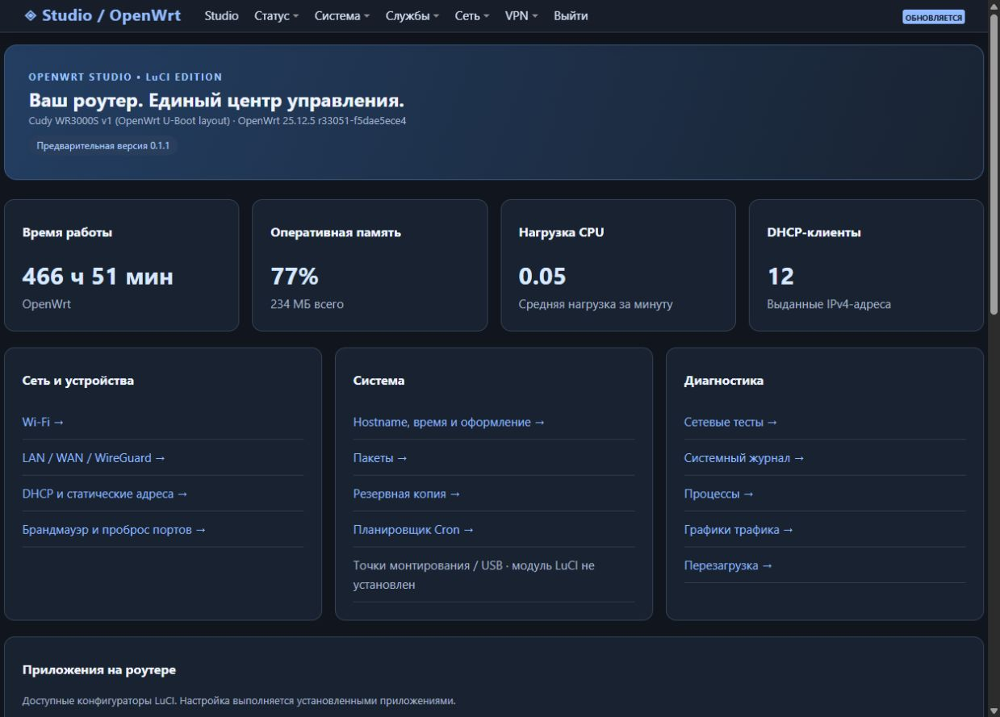

# OpenWrt Studio для LuCI · 0.1.1 preview

Отдельный проект веб-интерфейса OpenWrt Studio: тёмная тема **OpenWrtStudio**
и модуль **Studio** для LuCI. [Скачать пакеты](https://github.com/RichkovGit/OpenWrtStudio-LuCI/releases/tag/v0.1.1).

> Это предварительная версия, а не полный перенос Windows-программы.
> Конструкторы Mihomo/Sing-box, подписки, автоматическая установка ForkOP
> и Sentinel пока не перенесены.



## Возможности

- Время работы, память, нагрузка CPU и аренды DHCP с обновлением каждые 10 секунд.
- Карта зарегистрированных VPN-служб procd и ссылки на установленные приложения LuCI.
- Тёмное оформление стандартных страниц LuCI с адаптацией к телефону.
- Доступ к штатным формам Wi-Fi, LAN/WAN, DHCP, firewall, Cron, пакетов,
  диагностики и резервного копирования. Сами настройки выполняет LuCI.
- Модуль работает с любой темой; установка темы необязательна.
- Права модуля только на чтение показателей, DHCP и списка служб.

## Выбор пакета

| Прошивка | Менеджер | Файлы |
| --- | --- | --- |
| OpenWrt 24.10 с ucode LuCI | opkg | `luci-app-openwrtstudio_0.1.1-1_all.ipk`, `luci-theme-openwrtstudio_0.1.1-1_all.ipk` |
| OpenWrt 25.12 | apk | `luci-app-openwrtstudio-0.1.1-r1.apk`, `luci-theme-openwrtstudio-0.1.1-r1.apk` |

Пакеты содержат JavaScript, CSS, JSON, ucode и shell, без машинного кода.
Архитектура IPK — `all`, APK — `noarch`. **IPK и APK не взаимозаменяемы.**
OpenWrt 21.02/23.05 и Lua-only LuCI не поддерживаются.
APK здесь — пакет OpenWrt, а не приложение Android.

## Установка

Сохраните резервную копию настроек. Скачайте нужные два файла и `SHA256SUMS.txt`
из [релиза v0.1.1](https://github.com/RichkovGit/OpenWrtStudio-LuCI/releases/tag/v0.1.1),
проверьте SHA-256 и загрузите пакеты в `/tmp` роутера.
При необходимости сначала обновите индексы пакетов штатной командой менеджера.

**OpenWrt 24.10:**

```sh
opkg install /tmp/luci-app-openwrtstudio_0.1.1-1_all.ipk /tmp/luci-theme-openwrtstudio_0.1.1-1_all.ipk
```

**OpenWrt 25.12:**

```sh
apk add --allow-untrusted /tmp/luci-app-openwrtstudio-0.1.1-r1.apk /tmp/luci-theme-openwrtstudio-0.1.1-r1.apk
```

APK пока без цифровой подписи. `--allow-untrusted` нужен только для этой установки;
постоянные настройки доверия и ключи системы не меняются. Проверяйте контрольные суммы.

Зависимости: модулю нужны `luci-base`, `luci-mod-status`, `luci-mod-network`,
`luci-mod-system`, `luci-app-firewall`; теме — `luci-theme-bootstrap`.
При отсутствии зависимостей менеджер установит их из ваших настроенных репозиториев.
Наличие USB-страницы и сторонних VPN-приложений зависит от установленных модулей.

Обновите страницу LuCI или выйдите и войдите снова. Панель доступна через
**Studio** в меню или `/cgi-bin/luci/admin/studio`.
Установка **не переключает тему**: выберите **OpenWrtStudio** в
**Система → Система → Язык и оформление**.

Если была установлена версия 0.1.0 вручную, пакеты принимают её файлы под управление
менеджера. Предыдущая тема останется выбранной. Перед переходом сохраните бэкап.

## Возврат темы и удаление

Выберите прежнюю тему в настройках LuCI. Установщик сохраняет её путь в
`/etc/openwrtstudio-original-theme` (только root). Если удалить активную тему
OpenWrtStudio через пакетный менеджер, скрипт вернёт сохранённую тему,
а при её отсутствии — Bootstrap. Файл с путём сохраняется после удаления.

```sh
# OpenWrt 24.10
opkg remove luci-app-openwrtstudio luci-theme-openwrtstudio

# OpenWrt 25.12
apk del luci-app-openwrtstudio luci-theme-openwrtstudio
```

Пакетный менеджер удаляет принадлежащие пакетам файлы; Wi-Fi, WAN, VPN и Cron
не перенастраиваются. Старые резервные копии от ручной версии 0.1.0 сохраняются.

## Проверки

- IPK: метаданные, права, JSON, содержимое архивов; установка и удаление реальным
  `opkg` из OpenWrt 24.10 в отдельном offline-root. Зависимости представлены
  тестовыми записями; это не проверка интерфейса на полноценной прошивке 24.10.
- APKv3: чтение метаданных штатным `apk` 3.0.5, установка, удаление и повторная
  установка на Cudy WR3000S с OpenWrt 25.12.5. Удаление активной темы возвращает Proton2025.
- Дашборд и тема проверены в браузере; мобильный экран — 390 × 844.
- После проверки на роутере оставлена Proton2025, оба пакета установлены.

## Сборка

```sh
python3 scripts/build-packages.py
# Для APK: Linux и apk-tools v3 со встроенным mkpkg
APK=/path/to/apk sh scripts/build-apk.sh
python3 -c "import sys,importlib;sys.path.insert(0,'scripts');importlib.import_module('build-packages').checksums()"
```

IPK строятся стандартной библиотекой Python в gzip/tar-формате OpenWrt
[`scripts/ipkg-build`](https://github.com/openwrt/openwrt/blob/openwrt-24.10/scripts/ipkg-build).
Сборщик проверяет содержимое пакетов. `SOURCE_DATE_EPOCH` задаёт фиксированное
время файлов для IPK. APK создаёт настоящий `apk mkpkg`, не переименование архива.
Результаты — `dist/`, промежуточные файлы — `build/`.

## Лицензии

Новый код: MIT, см. `LICENSE`. Шаблоны темы основаны на Bootstrap из LuCI
([commit 0e6537981036ea221a73e497920192179e9f74c3](https://github.com/openwrt/luci/tree/0e6537981036ea221a73e497920192179e9f74c3/themes/luci-theme-bootstrap)),
их уведомления об авторских правах сохранены. Apache-2.0 — `COPYING.Apache-2.0`.
CSS и значки Bootstrap используются из установленного `luci-theme-bootstrap`.

[Windows-приложение OpenWrt Studio](https://github.com/RichkovGit/OpenWrtStudio)
· [Скриншот телефона](screenshots/02-mobile.jpg)
